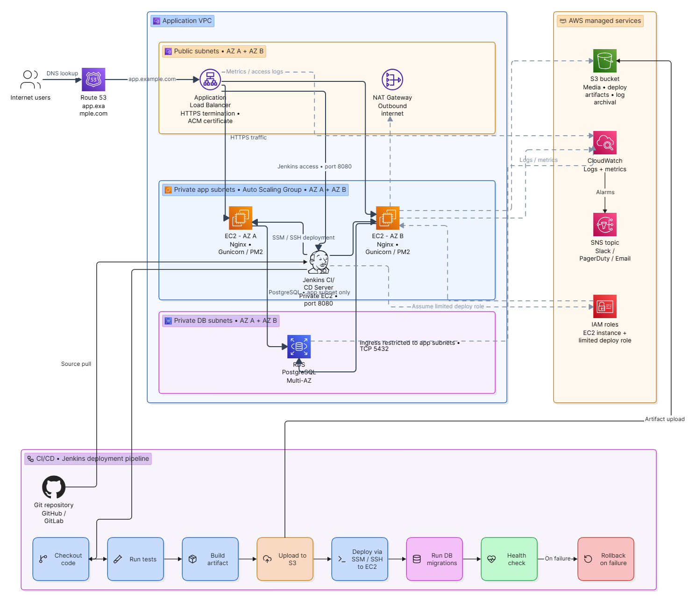

# Part 6: AWS Architecture

## Overview

The application is hosted on AWS using a standard three-tier VPC design: a public
subnet tier for internet-facing components, a private application tier for the
EC2 instances, and a private database tier for RDS. Deployments are handled by a
separate Jenkins CI/CD pipeline and pushes
releases into the app tier.

## Request flow (users → app)

1. **Route 53** resolves application domain name using public hosted zone and routes traffic to the **Application
   Load Balancer (ALB)**.
2. The **ALB** sits in the **public subnets** (spread across 2 Availability Zones),
   terminates HTTPS using an **ACM certificate**, and forwards requests to the
   application tier over HTTP.
3. The ALB forwards traffic to an **Auto Scaling Group of EC2 instances**
   (`EC2 - AZ A`, `EC2 - AZ B`), each running **Nginx + Gunicorn**, placed in
   **private application subnets**. These instances have no public IPs and are
   only reachable from the ALB.
4. The EC2 instances connect to an **RDS PostgreSQL (Multi-AZ)** database in the
   **private DB subnets**. The database is not publicly accessible and only
   accepts connections from the app subnet's security group.
5. A **NAT Gateway** in the public subnet gives the private EC2 instances outbound
   internet access (for OS patching and package installs) without exposing them
   to inbound traffic.

## Supporting services

- **S3** — stores deployment artifacts, user media, and archived logs. EC2
  instances read/write to S3 using their IAM instance role.
- **CloudWatch** — collects logs and metrics from EC2, RDS, and the ALB
  (CPU, memory, disk, 5xx errors, unhealthy targets, DB connections/storage).
  Alarms publish to an **SNS topic**, which notifies the team over
  Slack/PagerDuty/Email.
- **IAM** — two key roles:
  - *EC2 instance role*: scoped to only its own S3 prefixes, CloudWatch, and SSM.
  - *Jenkins deploy role*: scoped to upload artifacts to S3 and trigger
    deployments on the app instances, nothing broader.
- **Security groups**: `alb-sg` allows 443 from the internet; `app-sg` allows 80
  only from `alb-sg`; `db-sg` allows 5432 only from `app-sg`. No security group
  allows direct SSH from the internet.
- **Systems Manager (SSM)** — used to connect to the private EC2 instances for
  troubleshooting and configuration, instead of SSH. This means no bastion host
  and no open port 22, and every session is logged for audit purposes.
- **VPC Endpoints** — used so EC2 can reach AWS services (S3, SSM, CloudWatch)
  over the AWS backbone network instead of through the NAT Gateway, keeping that
  traffic off the public internet entirely and reducing NAT data-transfer cost.

## CI/CD flow (Jenkins)

1. **Checkout code** from the Git repository (GitHub/GitLab) on a push to `main`.
2. **Run tests** — unit tests and a migration dry-run against a test database.
3. **Build artifact** — package the application into a versioned tarball.
4. **Upload to S3** — store the artifact in the deployment-artifacts bucket,
   named by commit SHA.
5. **Deploy to EC2** — connect to the app instances via AWS Systems Manager (or
   SSH through a bastion/VPN if SSM isn't available) and pull the new artifact.
6. **Run DB migrations** against the RDS instance.
7. **Health check** — verify the app responds correctly on its health-check
   endpoint before finishing the deploy.
8. **Rollback on failure** — if the health check fails, Jenkins triggers the
   rollback script on the app instances to revert to the previous release.

Jenkins never gets broad AWS credentials: it assumes a narrowly-scoped IAM role
(S3 artifact upload + deployment commands to tagged instances only), and all
deploy actions are logged for audit purposes.

## Why this design

- **Public/private subnet split** keeps the app and database completely
  unreachable from the internet — only the ALB is public.
- **Multi-AZ for EC2 and RDS** gives the app tier and the database resilience
  against a single Availability Zone failure.
- **Immutable, artifact-based deploys** (via S3 + Jenkins) make every release
  reproducible and rollback trivial.
- **Centralized logging and alarms** through CloudWatch/SNS mean incidents (like
  the 502 scenario in Part 3) are caught and surfaced automatically, not just
  found by users.